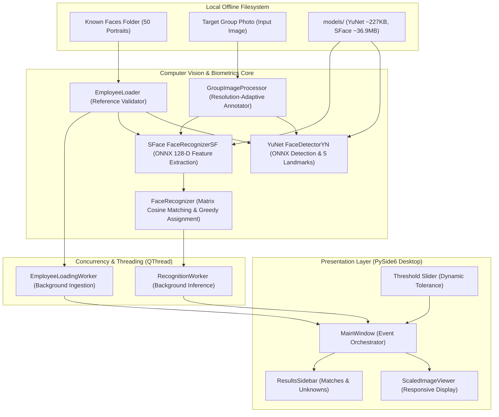
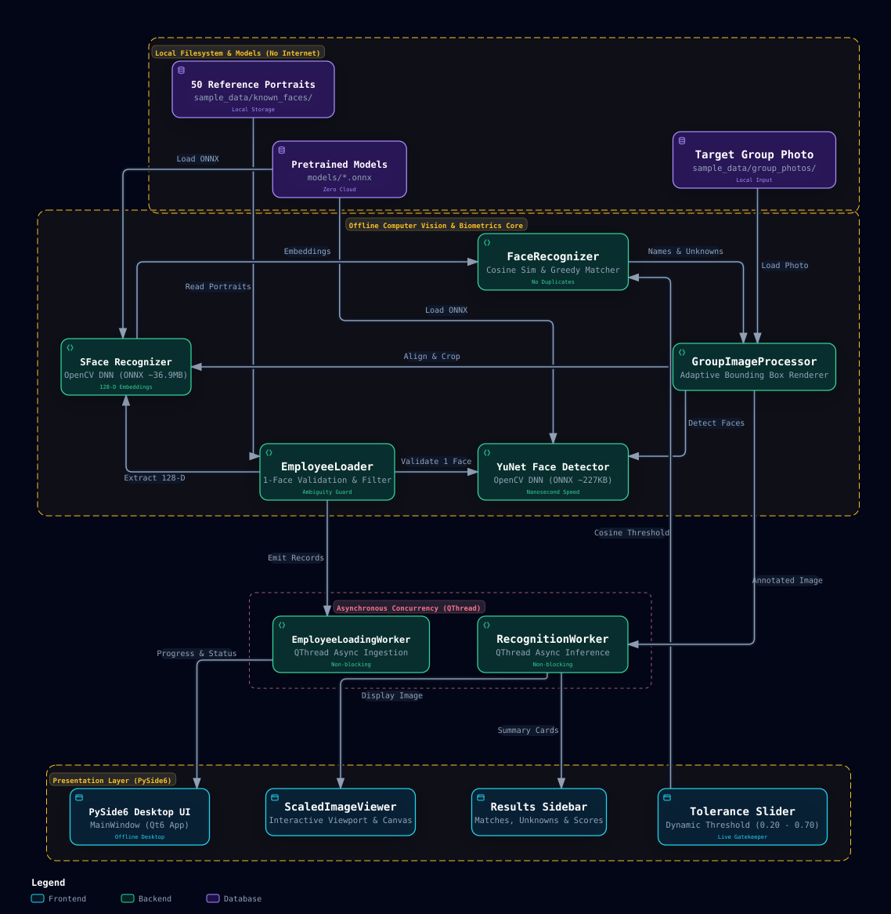

# System Architecture & Design (`ARCHITECTURE.md`)

This document outlines the architectural blueprint, data flow pipelines, component modularity, and trade-off decisions for the **Who Is in the Photo?** offline desktop application.

---

## 1. High-Level Architecture Overview

The system is structured using a clean separation of concerns between presentation, threading, computer vision inference, and mathematical identity resolution:

---

## 2. Component Breakdown

1. **Presentation Layer (`app/ui_main_window.py`):**
   * **`MainWindow`:** Central controller managing window geometry, dark-slate theme styling, button lifecycle states, and signal connections.
   * **`ScaledImageViewer`:** Custom `QLabel` subclass maintaining aspect ratio and high-DPI bilinear/Lanczos filtering during dynamic window resizes.
   * **`Results Sidebar`:** Tabular cards displaying recognized employees with confidence badges and unidentified persons tagged as **"Unknown"**.
   * **`Tolerance Slider`:** Live threshold slider (`0.20` – `0.70`) allowing instant sensitivity recalibration without reprocessing or re-extracting embeddings.

2. **Computer Vision & Ingestion Engine (`app/employee_loader.py`):**
   * **Validation Gate:** Strictly checks that each reference portrait contains **exactly 1 face**. Rejects 0 faces or multiple faces to eliminate identity ambiguity.
   * **Pose Alignment:** Uses 5 landmark coordinates (eyes, nose, mouth corners) with `recognizer.alignCrop()` for canonical frontal alignment.
   * **Biometric Embedding:** Generates an L2-normalized 128-dimensional embedding vector per employee.

3. **Recognition & Assignment Engine (`app/face_recognizer.py`):**
   * **Vectorized Pairwise Matching:** Stacks reference embeddings into a matrix $(M, 128)$ and detected group face embeddings into $(N, 128)$. A single BLAS matrix multiplication produces the full cosine similarity matrix $(N, M)$.
   * **Duplicate Prevention:** Implements a greedy global best-match assignment to guarantee that no employee identity is assigned to multiple physical faces in the same photograph.
   * **Threshold Rejection:** Rejects any similarity below the calibrated threshold ($\tau$), safely tagging unlisted individuals as **"Unknown"**.

4. **Group Image Processing & Annotation Pipeline (`app/image_processor.py`):**
   * Dynamically adapts line thickness, font size, and label collision offsets based on input photo resolution (e.g. 720p vs. 4K).
   * Renders color-coded bounding boxes: **Emerald Green** for identified personnel and **Amber/Orange** for unknowns.

5. **Asynchronous Concurrency Layer (`app/ui_main_window.py`):**
   * **`EmployeeLoadingWorker` (QThread):** Ingests reference directories asynchronously with progress signals.
   * **`RecognitionWorker` (QThread):** Executes face detection and embedding comparison in dedicated threads, completely preventing GUI freezing or OS "(Not Responding)" warnings.

---

## 3. Mathematical Identity Resolution Pipeline

1. **Vectorized Cosine Similarity:**
   For a detected face query vector $\mathbf{u} \in \mathbb{R}^{128}$ and reference employee vector $\mathbf{v}_j \in \mathbb{R}^{128}$ (both $L_2$-normalized):
   $$\text{Sim}(\mathbf{u}, \mathbf{v}_j) = \mathbf{u} \cdot \mathbf{v}_j = \sum_{k=1}^{128} u_k v_{jk}$$

2. **Greedy Disjoint Identity Assignment:**
   $$\text{Candidate Pairs } P = \left\{ (\text{Sim}(\mathbf{u}_i, \mathbf{v}_j), i, j) \mid \forall i \in [1, N], \forall j \in [1, M] \right\}$$
   Sort $P$ descending by similarity score. For each tuple $(s, i, j)$:
   * If face $i$ is unassigned and employee $j$ is unclaimed:
     $$\text{Identity}(i) = \begin{cases} \text{Name}_j & \text{if } s \ge \tau \\ \text{"Unknown"} & \text{if } s < \tau \end{cases}$$

---

## 4. Archify Architecture Diagram

The system architecture diagram below was generated using **[Archify](https://github.com/tt-a1i/archify)** as required by the project specifications:

  

* **Interactive Standalone HTML:** [docs/architecture/system_architecture.html](docs/architecture/system_architecture.html)
* **Light Theme SVG:** [docs/architecture/system_architecture-light.svg](docs/architecture/system_architecture-light.svg)
* **Dark Theme SVG:** [docs/architecture/system_architecture-dark.svg](docs/architecture/system_architecture-dark.svg)

---

## 5. Architectural Trade-offs & Engineering Decisions

| Choice Made | What We Gave Up | Rationale |
| :--- | :--- | :--- |
| **OpenCV Zoo (YuNet + SFace)** | InsightFace / heavy PyTorch stacks | Native C++ acceleration in standard OpenCV, lightweight memory footprint (~227 KB + ~36.9 MB), zero installation friction on Windows, and ultra-fast CPU inference (< 150 ms). |
| **PySide6 Native Desktop Application** | Web / browser-based dashboard | 100% offline security, zero port binding conflicts, native file dialogs, hardware-accelerated canvas rendering, and zero browser sandbox constraints. |
| **Greedy Global Identity Matching** | Naive per-face argmax | Prevents the mathematical absurdity of matching the same employee identity to multiple distinct individuals in the same photo. |
| **Asynchronous QThread Workers** | Synchronous execution | Keeps GUI responsive with interactive progress indicators during heavy batch operations. |
| **In-Memory NumPy Embedding Index** | Heavy external vector database | For 50 reference portraits, in-memory NumPy matrix multiplication executes in microseconds, avoiding database setup overhead. |
